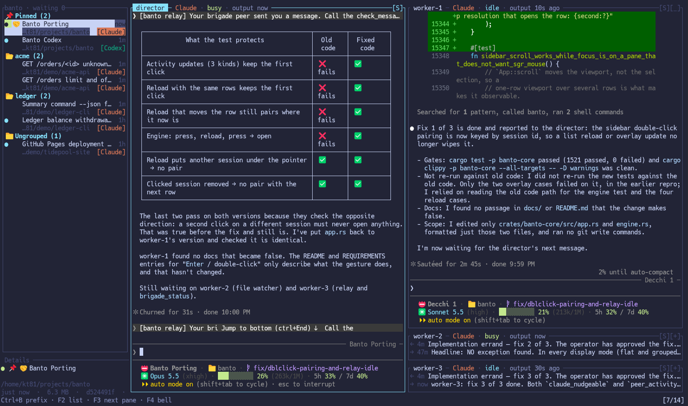

# banto (番頭)

[English](README.md)

*この日本語版は [README.md](README.md) の翻訳です。内容が食い違う場合は英語版が正です。*


**banto は、このマシンにどの Claude Code と Codex のセッションがあるか、どれがまだ生きているか、そしてあなたが本当に指していたのがどれかを知っています。**

`claude --resume` は、セッションの id さえ出せば開き直してくれます。banto はその id を探し出す側です。ディスク上のすべてのセッション（Claude Code のものは `~/.claude`、Codex のものは `~/.codex` の下）を曖昧検索できる台帳にまとめ、ピン留め・グループ分け・アーカイブを自分で重ねられます。そして、同じセッションを二重に開くのを拒む側でもあります。すでに動いているセッションを再開すると、その履歴がフォークしてしまうからです。

banto は全画面のターミナル UI がひとつだけです。左に台帳があり、右にはあなたが開いたセッションが、banto 自身がホストするライブのペインとして並びます。切り替えている間もペインは動き続けます。さらに、banto を介して互いに話せる Director/Worker の班（brigade。英語版では cell とも呼んでいます）に組むこともできます。

Claude Desktop を使うと、複数セッションでの作業がワークスペースのように感じられます。セッションが並んで表示され、状態がひと目で分かり、ペインは作業に合わせて配置を変えられます。banto は、それをディスク上にすでにある本物の `claude`/`codex` CLI のセッションに対して、ターミナルを離れずに実現しようとする試みです。

*名前の由来: 番頭（bantō）は、昔ながらの日本の商家で、店に詰めて商いを切り盛りする筆頭の奉公人です。*

**クロスプラットフォーム。ただし育ちは Windows。** 開発と最も濃いドッグフーディングは Windows Terminal + ConPTY 上で行っていて、Windows は第一級の対象です。ただしそれは作業場であって、目的ではありません。コードベースはクロスプラットフォームを保っていて（CI は Windows、Ubuntu、macOS でビルドとテストを行います）、Linux でのドッグフーディングも始まっています。

## なぜ tmux だけではだめなのか

tmux はターミナルのウィンドウマネージャです。banto は Claude Code と Codex のセッションのライフサイクルマネージャです。セッションの id、起動したディレクトリ、まだ動いているかどうか、そしてあなたがどれをどこに仕分けたかを知っています。行を選ぶことは、たまたま `claude` が動いているシェルを開くことではありません。特定のひとつの会話に戻ること、あるいはその会話をすでに持っているプロセスに戻ることです。

banto はマルチプレクサを操作しません。ペインは自分でホストします。マルチプレクサには、banto がペインに対して行うことを担えないからです。ペインの隣に置く台帳、自分がどの班に属するかを知っているセッション、セッション間で中継されるメッセージがそれにあたります。

## なぜ herdr だけではだめなのか

[herdr](https://github.com/herdrdev/herdr) は、コーディングエージェント向けに作られたターミナルマルチプレクサです。バックグラウンドのサーバーがペインを所有し、デタッチして後で戻ってこられ、20 を超えるエージェントのうちどれが作業中で、どれがブロックされ、どれがアイドルかを表示します。種類を問わず多数のエージェントを、デタッチやマシン、SSH 接続をまたいで生かし続けたいなら、それは herdr の仕事で、banto にはできません。

banto の主題は端末ではなくセッションです。Claude Code と Codex 自身のファイルを読み取り専用で読むので、banto が存在する前や banto の外で始めたセッション、そのうちまだ動いているもの、そしてあなたが指していたのがどれかを把握できます。どちらのエージェントのホームにも決して書き込まず、同じ会話を二度再開することもありません。herdr は、セッションの id を自分のペインで動くエージェントから、その連携がエージェントの設定にインストールするフックを通じて知ります。banto はさらに、セッション間のメッセージを banto 自身が中継する Director/Worker の班もホストします。herdr の場合は、スクリプトやエージェントが互いを動かせるように CLI とソケット API を渡します。トレードオフはこうです。banto が話せるエージェントは二つで、banto より長生きするサーバーは持ちません。

## できること

左の台帳には名前があります。**帳場**（chōba、帳場は「店の勘定台」の意）です。全セッションの一覧で、Claude Code が `~/.claude` の下に書くセッションファイルと、Codex が `~/.codex` の下に持つセッション索引を索引化して作ります。常に読み取り専用です（後述）。検索し、ピン留め・グループ分け・アーカイブをし、選んだ、あるいは入力したディレクトリで新しいセッションを始められます。

そこで選んだものは、右側のペインで開きます（大店、*emporium*。banto 自前のホスト型ペイン表示です）。banto は最小限の組み込みマルチプレクサです。常駐するサイドバーと、vt100 でパースされるペインにホストされたセッションからなり、Vim のバッファのように切り替えられ、切り替えの間もセッションはバックグラウンドで生き続けます。

セッションがすでに banto のペインで開いていれば、それを選ぶとそのペインに切り替わります。banto の外のどこか（別の banto や、別のウィンドウで素のまま動いている `claude`）で動いている場合、banto は二つ目の起動を拒み、その旨を伝えます。これがこのページの冒頭で述べた保証です。すでに動いているセッションを再開すると、その履歴がフォークしてしまうのです。

### Director/Worker の班



*稼働中の班（WSL 上）です。Director が各テストの守っているものを整理し、Worker が修正を報告しています。さらに 2 つの Worker は帯に折りたたまれています。このスクリーンショット自体がドッグフーディングで、映っている班は banto のバグを直している最中です。*

`B` は、選択したセッションを **Director** に任命し、その隣に新しい **Worker** セッションを自動で起こします（数もモデルも、さらにはプロダクトまで設定できます。班の Worker は、Director 自身のプロダクトとは別に、Claude Code でも Codex でも動かせます）。Worker のモデルと reasoning effort（推論の強さ）は、そのセッションを作るときに渡され、開き直すときには渡されません。そのため、セッションの中で行った変更は banto を再起動しても保たれます。

banto は両者の間のメッセージチャネルを MCP 上で仲介します。各メンバーの起動時に、そのメンバーを `banto _mcp` につなぎます。Claude Code には `--mcp-config` で、Codex には `-c mcp_servers.banto.*` の上書きで渡します。これによりメンバーは、banto 自身の sqlite キューに支えられた `send_to_peer` / `check_messages` / `brigade_status` ツールを使えます。加えて、Director だけが使えるツールがあります:

- `consult_goinkyo` / `dismiss_goinkyo`
- `request_decision`: あなたにしか下せない判断を Director が待っているときのためのものです。Director は質問を自分のペインに書き、banto はそこに `▸ decision` タグを付けます。Director を止めはせず、あなたがそのペインで Enter を押すまでタグは残ります
- `interrupt_worker`: Director が Claude の Worker に出した仕事を考え直したときのためのものです。Worker の実行中のターンを Esc 1 回で止め、その理由を通常のメッセージとして渡します。banto が Esc を押すのは Worker がターンの途中にいるときだけで、押すたびにステータス行でお知らせします。Codex の Worker にはメッセージは届きますが、まだ中断はされません
- `name_member`: Director が Worker に与えた常設の役割に対して、Worker に表示名を付けます。表示名はタイルのタイトル、`brigade_status`、メッセージのヘッダで、トークンの隣に表示されます。宛先になるのは引き続きトークンです

各メンバーには、所属する班、自分のトークン、同僚を示す役割ブリーフィングも渡されます。Claude Code では起動時にシステムプロンプトへ追記します（再開時は、セッション自身が持つシステムプロンプトの記録がそのまま再利用されてしまう場合に、`--system-prompt-snapshot off` を付けます。このフラグには Claude Code 2.1.267 以降が必要です）。Codex は独自の `--append-system-prompt` を持たないため、banto 自身の `SessionStart` フックで届けます。ブリーフィングがなければ、班は banto のデータモデルと操作者の画面の中にしか存在せず、3 つのツール名だけを渡された Director は、たいてい使いません。`brigade_status` は、その続きの疑問に答えます（チームに誰がいるか、何をしているか、自分が送ったメッセージを誰かが抱えていないか）。

メッセージの本文は pull 方式で取得されます。メンバーごとのカーソルを使い、中継されたメッセージには、別の AI から来たものだと明示する枠付けをするので、操作者の入力と取り違えられることはありません。banto の**自動リレー**は、未読メッセージを持つアイドルのメンバーを見張り、短い定型のナッジ（促し）をその標準入力に打ち込んで起こします。これにより、Director→Worker→Director の往復に、人手による橋渡しはまったく要りません。リレーが有効（`relay = "auto"`）のとき、この起こし方はメンバーの文脈全体に対するターンを始めます。そのため、メッセージが何も求めていなくても、アイドルのメンバーに 1 ターン分の費用がかかることがあります。このリポジトリの大部分は、このループを通じて作られました。

班のすべての生きているメンバー（Director、Worker、ご隠居（Goinkyo））が、誰かが実際に作業をしてから 5 秒間アイドルだった場合、班は静まったとみなされます。あなたの入力が求められる瞬間です。起動は作業に数えません。5 秒は、最後のメンバーがアイドルになった時点、または banto が最後にメンバーへプロンプトを送った時点から数えます。banto はそのとき Director に印を付け（一覧の行の待機ドット、サイドバーの `waiting N` への計上、待機中のセッションのペインに付くマゼンタの枠。ただしフォーカス中のペインはフォーカスの色のままです）、ターミナルのベルを鳴らします。Director のペインを見ているあいだ（そのペインが選択され、banto のウィンドウがフォーカスされているとき）は、印も付かず、鳴りません。ウィンドウがバックグラウンドにあるときは、印を付けて鳴らします。状態を読み取れないメンバーがいるあいだは、ベルは鳴りません。banto がまだキックオフ（最初のターンを始める最初の一行）を打ち込んでいない新しい Codex の Worker やご隠居がいる場合や、まだ届く途中の未読の報告を持つメンバーがいる場合も同様です。

画面に出ていない班にも通知は届きます。その班が静まると Director の行に印が付いてベルが鳴り、別の班で作業している最中でも同じです。また、その班のメンバーがあなたを待っている場合（あるいはその子プロセスがベルを鳴らした場合）も、その行に印が付いて一度鳴ります。印は、その Director のペインに着いたときに消え、班を開いても再び鳴ることはありません。自分で Claude のペインに開いたピッカー（`/model` のようなスラッシュコマンド）は待機として表示されますが鳴らず、開いているあいだは、その班が静まったと数えられるのを防ぎます。`F4` は「Director のペインにフォーカスがあっても鳴らす」を切り替えます（ベルだけで、印は付きません）。オンのあいだはステータスバーのカウントの左に `BELL ALWAYS` と表示され、この設定は再起動をまたいで保持されます。

最初の Codex の班を作るには、あなたにひとつだけお願いがあります。Codex は起動時に banto のフックを信頼してよいか確認しますが、それは一度きりで、起動のたびではありません。そのため banto は、最初の班ができる前に、承認用のペインを一度だけ開きます。それを承認してください。一度承認すれば、以降の班の起動ではすでに信頼済みになっています。

## 状況と注意点

- 個人用のツールで、1.0 前で、速いペースで変化しています。インターフェースとディスク上のスキーマは前方へ移行されますが、まだ何も約束していません。UI がデータベースを移行する前に、その隣へ `banto.db.before-v<N>` としてコピーを作ります（スキーマ `N - 1` の時点のデータベースです。ビルドが持つスキーマは `banto --version` で分かります）。古いビルドは、新しいビルドが移行したデータベースを開けません。コピーを戻すか、新しいビルドを使ってください。
- **スーパーバイザープロセスは置きません。意図的にそうしています。** banto のペインにホストされたセッションは、banto が終わると終わります。それぞれにまず通常のコンソールクローズを送るので、`claude` はウィンドウを閉じたときと同じように履歴を確定し、セッションは次回きれいに再開できます。ただし banto は、あなたが座って使う作業台であって、あなたの背後で仕事を動かし続けるデーモンではありません。
- Claude Code のセッションファイルの形式は**ドキュメント化されておらず、変更される可能性があります**。banto は寛容なパース（未知のレコードや壊れた行は読み飛ばし、致命的にはしません）と合成フィクスチャのテストで備えていますが、将来の Claude Code のリリースが banto を驚かせる可能性はなお残ります。
- banto 自前のペインのホストは ConPTY を話しますが、これには落とし穴があります（[docs/notes/embedded-pty-spike.md](docs/notes/embedded-pty-spike.md) に記録しています。DSR/DA には決して応答しない、チャンクの境界が意味を持つ、子プロセスの終了で EOF が出ない、など）。これらは対処済みです。ConPTY はもっとも落とし穴の多かった場所で、Windows 側に意識的に手厚く手を入れているのはそのためです。

## 読み取り専用の保証

**banto は `~/.claude` や `~/.codex` の下には決して何も書き込みません。** セッションの `.jsonl` ファイル、ライブ状態のファイル、履歴、Codex の `threads` と `logs` の sqlite データベース（それぞれセッション索引と生存確認用）は、すべて厳密に読み取り専用です。banto 自身のデータは、banto 自身のディレクトリの下にあります。

- 設定: 既定では `dirs::config_dir()/banto/config.toml`
  （Windows: `%APPDATA%\banto\`）。解決順序の全体（`--config`、`$BANTO_CONFIG`、XDG、`~/.config`）は
  [設定](#設定)を参照してください
- データ（sqlite と作業ファイル）: 既定では `dirs::data_local_dir()/banto/banto.db`
  （Windows: `%LOCALAPPDATA%\banto\`）。設定の `data_dir` か `$BANTO_DATA_DIR` で別の場所を指定できます
  （[設定](#設定)を参照）。`~/.claude` や `~/.codex` の内側にあるデータディレクトリや `db_path` は
  （どんな名前で到達しても、リンク経由でも）拒否されます。UI と `banto _mcp` は起動に失敗し、
  エージェントのフックは黙ってストアを開きません。

MCP の配線もこれを守ります。メンバーごとの `--mcp-config` ファイルは banto のデータディレクトリの下に書かれ、argv で渡されます。Claude 自身の設定には決してインストールされません。

データベースごとに banto の UI はひとつです。実行中の banto がすでに使っているデータベースを開こうとする二つ目の `banto` は、起動を拒否し、そのデータベースと、分かる場合は保持しているプロセスの id を示します（ロックはデータベースの隣の `banto.db.lock` で、保持者が終了すれば、終わり方を問わず消えます）。二つ目の banto を動かすには、専用のデータディレクトリかデータベースを与えます。`BANTO_DATA_DIR`、設定の `data_dir`、`db_path` です（隠しフラグの `--data-dir` / `--db-path` でも指定できます）。ロックを扱わないファイルシステムでは確認できません。その場合 banto は起動し、ステータス行でそのことを伝えます。

**名指しする例外がひとつあります。** Codex の sqlite データベースの読み取り（セッション索引は `state_5.sqlite`、生存確認は `logs_2.sqlite`。同じ方式がそれぞれについて独立に再検証されていて、一方で成り立つから他方でも成り立つと仮定したわけではありません）です。Codex 自身が書き込んでいるかもしれないあいだに読むには、SQLite 自身の読み取り専用の仕組みが要ります。どれを使うかは、どのサイドカーファイルがあるかで決めます。`-wal` ファイルがあるとき（Codex が活発に書き込んでいるかもしれないデータベース）は `mode=ro`、ないとき（きれいに閉じられたデータベース。ただし `immutable=1` だけに頼ると、確認と open のあいだに書き手が動き出した場合に、古いスナップショットを返しうる）は `immutable=1` です。追加の書き込みなしには済まないのが、クラッシュの残骸のケースです。`-shm` サイドカーなしに `-wal` が残っている場合（たとえば Codex が書き込み中に強制終了された）、最初の `mode=ro` の open が新しい `-shm` を作り直します。約 32KB の一度きりの書き込みで、banto のデータではなく SQLite 自身の調整用インデックスであり、Codex 自身の次の実行でもどのみち作られるものです。「banto は書き込まない」という言葉が他のどの箇所でも文字どおりに成り立つよう、ごまかさずここに明記します。

## インストールとアップグレード

**必要なもの。** `PATH` 上の `claude`（Claude Code）か `codex`、またはその両方。banto は本物の CLI をホストするもので、同梱はしません。どちらかが別の場所にある場合は、`config.toml` で場所を指定してください:

```toml
[agent_binaries]
claude = "C:/tools/claude.exe"
codex = "C:/tools/codex.exe"
```

**対応プラットフォーム。** Windows x64、glibc 2.35 以降の Linux x64（リリースは Ubuntu 22.04 でビルドされ、バイナリがそれより新しい glibc を必要とするとビルドが失敗します。Alpine のような musl のシステムはソースからビルドします）、そして Apple silicon の macOS。Intel Mac と Windows on ARM 向けのビルド済みバイナリはありません。Windows は banto が開発され、毎日使われている場所です。

**macOS は軽く確認した段階です。** Apple silicon の Mac 1 台で、v0.1.0 は `install.sh` でインストールでき、何にも止められませんでした（Gatekeeper のプロンプトは出ませんでした）。セッションをペインで開いて閉じることができ、ペインで選択したテキストはコピーできました。再開、セッションファイルの変更に一覧が追従すること、入力の細部は、まだそこでは確認していません。ブラウザでダウンロードしたバイナリも同様です。

### 一行で

Windows: 開いている PowerShell（Windows PowerShell 5.1 または PowerShell 7）に、次を入力します。`-ExecutionPolicy` のラッパーは不要です:

```powershell
irm https://github.com/kt81/banto/releases/latest/download/install.ps1 | iex
```

Linux と macOS:

```sh
curl -fsSL https://github.com/kt81/banto/releases/latest/download/install.sh | sh
```

インストーラは、お使いのプラットフォーム用のアーカイブと `SHA256SUMS` をリリースからダウンロードし、アーカイブをそれと突き合わせて、一致しなければ何もインストールしません。（`SHA256SUMS` はアーカイブと同じリリースから来るので、この確認で分かるのはダウンロードが破損なく届いたことで、誰がビルドしたかではありません。それについては、[手動インストール](#手動インストール)の attestation を参照してください。）置き換える前に新しいバイナリを一度実行するので、お使いのマシンで起動できないビルド（Linux では 2.35 より古い glibc）は、いま入っている banto に手をつけません。インストーラが行う `--version` の実行は、システムに `timeout` コマンドがあってもなくても 10 秒で打ち切られるので、ハングする banto は、待たずに拒否されます。以前の強制終了されたインストールがインストール先のディレクトリに残したステージング用ファイル（`.banto.<random>`、`.banto-<hex>.exe`、1 時間以上前のもの）は削除されます。banto ではない `banto` は、上書きを拒否します。`PATH` 上にあるものでも、インストール先にすでにあるファイル（ラッパースクリプトやパッケージマネージャの shim）でも同じです（実行でき、`--version` に `banto ...` と答える必要があります）。`PATH` 上に banto が複数あれば警告します。置き換えるのは最初のひとつだけで、残りは自分で消すことになります。`banto --version` を前後に表示します（初回インストール前は `(not installed)`）。`PATH` やシェルのプロファイルは編集しません。ディレクトリが `PATH` にないときは、それを追加する一行を表示します。

banto が置かれる場所は、次の順です:

1. すでに `PATH` 上にある `banto`（その場で置き換えます）
2. `BANTO_INSTALL_DIR`（`PATH` 上にまだ banto がないとき）
3. Windows では `%USERPROFILE%\.local\bin\banto.exe`、それ以外では `~/.local/bin/banto`

二つの環境変数で、この一行の動作を変えられます。PowerShell では同じウィンドウで先に設定し、Unix シェルではパイプの `sh` 側に付けます:

```powershell
$env:BANTO_VERSION = 'v0.1.0'            # a release tag instead of the latest
$env:BANTO_INSTALL_DIR = 'C:\tools\banto' # where, if no banto is on PATH yet
irm https://github.com/kt81/banto/releases/latest/download/install.ps1 | iex
```

```sh
curl -fsSL https://github.com/kt81/banto/releases/latest/download/install.sh | BANTO_VERSION=v0.1.0 BANTO_INSTALL_DIR="$HOME/bin" sh
```

### 手動インストール

お使いのプラットフォーム用のアーカイブを
[Releases ページ](https://github.com/kt81/banto/releases)（`banto-<tag>-x86_64-pc-windows-msvc.zip`、
`banto-<tag>-x86_64-unknown-linux-gnu.tar.gz`、`banto-<tag>-aarch64-apple-darwin.tar.gz`）から
`SHA256SUMS` と一緒にダウンロードします。アーカイブの sha256 を `SHA256SUMS` のその行と比べ
（PowerShell では `(Get-FileHash <archive>).Hash`、Linux では `grep <archive> SHA256SUMS | sha256sum -c -`、
macOS では `grep <archive> SHA256SUMS | shasum -a 256 -c -`）、そのうえで、単一の `banto` / `banto.exe` を
選んだディレクトリに展開します。そこが banto の置き場となる唯一のディレクトリになるようにしてください（後述）。
バイナリは署名されていないため、ブラウザでダウンロードした `banto.exe` をエクスプローラーでダブルクリックして
起動すると、SmartScreen の "Windows protected your PC" が出ます。"More info" → "Run anyway" で起動できます。
ターミナルから起動した場合や `install.ps1` でインストールした場合は、v0.1.0 ではメンテナーのマシンでプロンプトは出ませんでした。

各アーカイブには、どのコミットとワークフローがビルドしたかを示すビルド来歴の証明（attestation）も付いています。
[GitHub CLI](https://cli.github.com/) では次のとおりです:

```sh
gh attestation verify banto-v0.1.0-x86_64-pc-windows-msvc.zip --repo kt81/banto
```

これが検証するのはダウンロードしたアーカイブであって、そこから取り出した exe ではないので、展開する前に実行してください。
ファイルの出どころを示す、ここにある唯一の確認です。`SHA256SUMS` の確認は、アーカイブを同じリリースで公開された一覧と
比べるだけなので、ファイルが破損なく届いたことしか分かりません。

### ソースから

```sh
cargo install --git https://github.com/kt81/banto banto --locked
```

最近の stable な Rust ツールチェーン（edition 2024）と C コンパイラが必要です（同梱の SQLite は C からコンパイルされます）。`~/.cargo/bin` にインストールされます。あとで上のインストーラを実行すると、`PATH` 上のそのコピーを見つけ、その場で置き換えます。

開発用には、チェックアウトから:

```sh
cargo build --release

# The UI: the session list on the left, banto-hosted panes on the right
cargo run --

# Plain-text session listing
cargo run -- list

# Point at a different Claude home
cargo run -- --claude-home /path/to/.claude
```

（`--emporium` とその別名 `--oodana` は、banto に二つのモードがあった頃のものです。今も受け付けられますが何もせず、いずれ削除されます。）

### マシンに banto は一つだけ

banto のバイナリは、スペースを含まないひとつのパスに、ちょうどひとつだけ置いてください。Codex は banto の `SessionStart` フックを、フックの完全なコマンドで信頼確認し、そのコマンドには banto 自身のパスが含まれます。したがって別のパスにある banto のコピーは、Codex にとって別のフックです。最初のコピーの信頼にそれが何をもたらすかは、信頼ハッシュの作り方からの推測で、観測したものではありません（下の注を参照）。スペースを含むパスはフックにまったく書き込めないため、Codex のメンバーは役割ブリーフィングなしで起動します（Claude Code のメンバーは影響を受けません）。同じパスでファイルを置き換えたとき信頼が保たれたことは、観察できた一件で確かめています（2026-11-18。[注](docs/notes/codex-briefing-spike.md#addendum-2026-11-18-replacing-banto-at-the-same-path-keeps-the-trust)を参照）。インストーラが二つ目のコピーを入れず、常にその場で置き換えるのはそのためです。インストーラは、スペースを含むパスと `PATH` 上の二つ目の banto について警告しますが、どちらも拒否はしません。

### アップグレード

banto を終了し、同じインストール行を実行して、banto をまた起動します。

- **先に終了する理由。** どちらのインストーラも、置き換え先のファイルから banto が動いているあいだは拒否します。Windows ではどのみちファイルを置き換えられません。Linux と macOS では、動作中の banto の下でファイルを置き換えられますが、その banto は、自分が起動するヘルパーが UI とは別のビルドになってしまうため、再起動するまでメンバーを開くことを拒否します（`banto was replaced on disk; restart banto`）。（リリースのワークフローは、動作中の banto の拒否を Windows と Linux で試験します。macOS では、`lsof` ベースの検出がまだそこで動いたことがないため、そのステップは失敗が許容されています。）
- **アップグレード後の最初の起動**は、データベースをその場で移行します。移行の前に、データベースの隣へ `banto.db.before-v<N>` としてコピーを作ります（スキーマ `N - 1` の時点のデータベースです。[状況と注意点](#状況と注意点)を参照）。古いビルドは、新しいビルドが移行したデータベースを開けないので、元に戻すには古いビルドとそのコピーが必要です。スキーマ 19 への移行では、Claude Code 2.1.318 より前に行われたコンパクションの祖先を隠さなくなります。それらは通常の一覧に、続きのセッションと並んで表示されます。
- **データベースごとに banto の UI はひとつ。** 実行中のものがすでに使っているデータベースを開こうとする二つ目の `banto` は、起動を拒否します。二つ動かす方法は[読み取り専用の保証](#読み取り専用の保証)を参照してください。

### Windows Defender

2026-11-06、Microsoft Defender のリアルタイム保護が、ローカルでビルドしたリリース版 `banto.exe` を、機械学習による検出 `Trojan:Win32/Bearfoos.A!ml` として検知し、対処（remediation）しました。対処はプロセスを終了させるため、banto とそれがホストしていたすべてのセッションが一度に閉じられました。デバッグビルドは検知されず、この検知は同日の定義ファイルの更新とともに現れました。詳しい経緯は [docs/notes/windows-defender.md](docs/notes/windows-defender.md) にあります。

あなたにとっての意味: リリースビルドが検知されると banto とそのセッションが終了するので、起こりうることを知っておく価値があります。リリースからダウンロードした banto を Defender が検知した場合は、その sha256 を `SHA256SUMS` と比べ（`gh` があれば上の attestation の確認も実行し）、検出名と定義ファイルのバージョンを添えて[issue を開いてください](https://github.com/kt81/banto/issues)。「直す」ために除外を追加するのはやめてください。除外したディレクトリは、本当に改ざんされたファイルも見えなくしてしまいます。

### アンインストール

唯一の `banto` バイナリを削除します（`where.exe banto` / `command -v banto` で見つかります）。banto のデータも消すには、設定ディレクトリ（`config.toml`）とデータディレクトリを削除します（データベース `banto.db`、そのロックファイル `banto.db.lock` と `banto.db.lock.pid`、`banto.db.before-v<N>` のコピー、そして作業ファイル: MCP 設定、相談リクエスト、メッセージログ）。場所は[読み取り専用の保証](#読み取り専用の保証)と[設定](#設定)にあり、`data_dir`、`BANTO_DATA_DIR`、`db_path` によって別の場所になっていることがあります。セッションは、各エージェントが保管している場所に残ります。

banto は `~/.claude` や `~/.codex`（または `$CODEX_HOME`）には何も書きませんが、[読み取り専用の保証](#読み取り専用の保証)に書いた名指しの例外がひとつあります。Codex のデータベースを読むと、その隣に約 32 KB の `-shm` ファイルが残ることがあります。そこにはもうひとつ banto に関係する記録がありますが、banto がしたことではありません。banto の Codex フックを承認する（班ができるときに出る信頼のプロンプト）と、Codex 自身がその承認を、`<codex home>/config.toml` に `trusted_hash` を持つ `[hooks.state.'…<session-flags>…:session_start:0:0']` テーブルとして記録します。残しておいても害はなく、そのフックが承認されたことを示すだけです。削除するには、Codex の `config.toml` のそのテーブルを手で消してください。（この件で削除を試したことはないので、その後 Codex がどうするかは未検証です。banto 自身の確認は、そのフックを単にまだ承認されていないものとして読むことになります。）

## キー

表はひとつです。最初のグループが一覧のキーで、残りはペインが加えるものです。

ホストしているセッションがすべてアイドルと分かっているとき、またはホストしているものがないときは、`q`/`Esc` は即座に終了します。そうでなければ先に確認を求め、3 秒以内に 2 回目の `q`/`Esc` を押すと終了します。終了するとホストしているすべてのプロセスが終わるからです。ステータスバーは、数えた各セッションとその理由を挙げます。たとえば `Esc again to quit — 2 not idle: レビュー (unknown), 実装 (busy)` です。理由は次のとおりです。`unknown`（ペインから何も読み取れなかった、またはダイアログが出ている）、`input`（直近 3 秒以内に、あなたがキーやペーストを与えた、または banto が何かを打ち込んだ。クリックやスクロールは数えません）、`busy`（作業中または待機中と読み取れた、または banto が認識しない状態）。ターンは終わっているがバックグラウンドでコマンドを走らせたままの Claude Code セッションも数えられます。アイドルでないセッションの隣に `(bg)` として表示され（`2 not idle, 1 in background: a (unknown), b (busy), c (bg)`）、それだけのときは `2 in background: x, y` になります。

先に数、次に名前が来ます。名前の順序は、unknown が先で（unknown のペインには印の付くタイルがないため）、次に input、busy、background で、各グループの中は名前順です。名前は次のように表示されます。Director は一覧の行のタイトル（なければトークン）、Worker やご隠居は表示名（なければトークン）、その他のペインは一覧に表示されるとおりの名前です（まだセッションに解決されていないプレースホルダは `new session` と表示されます）。名前は 11 カラムで切られ、二つが同じ表示になるときは `#…` の接尾辞が付きます（最後の手段である id 全体の接尾辞は、11 を超えることがあります）。質問はステータス行の一行なので、最初の名前より後は切れることがありますが、前にある数は常に全体の数です。

セッションは一度だけ数えられ、直近 3 秒のあいだに作業を与えられたときはアイドルでないとされます。Claude Code のセッションは自分で自分の状態を報告し、Codex のセッションもそうです。banto は Codex のインターフェースが端末に書くステータス報告（作業中、あなた待ち、完了、アイドル）を読み、セッションがまだ一度も報告していないあいだは、rollout にある最後のターンを読みます。Codex はバックグラウンドに残したコマンドについて何も記録しないため、報告していない Codex セッションはアイドルと読まれます。

終了が決まると、ステータスバーは banto が終了するまで `Closing — ending N session(s)…`（ないときは `Closing…`）と表示します。各セッションは順に閉じられ、終了するまで最大 5 秒の猶予が与えられます。

| キー | 動作 |
|---|---|
| `j`/`k`、矢印、`PgUp`/`PgDn`、`Home`/`End` | 選択を移動 |
| `Enter` / ダブルクリック | セッションをペインで開く（すでに開いていればそれに切り替える）。Director では、その班全体をステージに出す（右側のペインに並べて表示する） |
| `n` | 新しいセッション（cwd を選ぶか入力する） |
| `/` | 検索（曖昧検索、タイトル + cwd） |
| `p` / `d` / `g` | ピン留め / アーカイブ（ソフトハイド）/ グループに入れる |
| `Tab` | グループ表示（Pinned / グループ / Ungrouped）の切り替え |
| `a` | 一覧が見せる範囲を順に切り替える: 通常のセッション → 隠れたもの（エージェントが起動したもの）も → アーカイブ済みも |
| `D` | 選択したセッションを復元（アーカイブ解除）する。アーカイブ済みを表示しているとき |
| `q` / `Esc` | 終了（セッションがアイドルでない、またはバックグラウンドでコマンドを実行中のときは、2 回押す必要がある。上記参照） |
| `B` | Director を任命し、Worker を自動起動する（Director の上では: 解散） |
| `b` | ステージ上の班に Worker をもうひとつ起こす |
| `x` | 選択した行が動かしているものを終了する（確認あり）。Director では**その班を畳む**。ステージ上かどうかは問わない。班のすべてのプロセスが終わり、何も削除されないので、Director の行で Enter を押せばすべてが戻る。ペインが開いている単独のセッションでは、そのプロセスを終了する。Worker を班から外すことは決してない。それには、その Worker のタイルで `Ctrl+B x` を使う |
| `F2` | フォーカスを一覧とペインの間で移動する |
| `F3` | ステージ上の班の次のペインを現在のペインにする（折りたたまれたタイルは飛ばす）。一覧から押したときは、キーボードは一覧に残る |
| `F4` | 班のベル（「Director/Worker の班」を参照）を、「見ているあいだは鳴らさない」と「Director のペインにフォーカスがあっても鳴らす」の間で切り替える。一覧からでもペインからでも一回のキー入力で、banto が受け取りエージェントには送られない。後者のあいだ、ステータスバーに `BELL ALWAYS` と表示される |
| `Ctrl+B` … | tmux 風のプレフィックス（設定可能）。一覧からでもペインからでも使える: |
| … `o`/`Tab` | サイドバーとペインの間でフォーカスを順に移す |
| … 矢印 | 方向を指定してペインを移動する |
| … `Shift`+`Up`/`Down` | フォーカス中のスタックのタイルを 1 つ上/下へ動かす（フォーカスはそのタイルに残る） |
| … `m` | フォーカス中のスタックのタイルを帯に折りたたむ、または開き直す |
| … `z` | フォーカス中のタイルをソロにする（マスターも含む。ソロにしたもの以外のスタックのタイルはすべて折りたたまれる）、またはソロを解く |
| … `M` | 折りたたまれたタイルをすべて開き、ソロを解く |
| … `=` | ステージ上の班のタイルのサイズを既定に戻す（順序、折りたたまれたタイル、サイドバーの幅は保たれる） |
| … `1`-`9` | ペイン N へ移動 |
| … `s` | サイドバーに戻る |
| … `Esc` | プレフィックスを取り消す（フォーカスはそのまま。子プロセスには何も送られない） |
| … `x` | フォーカス中の Worker/ご隠居を班から外す（確認あり。二度と班には戻らず、セッションは残る）。Director では班全体を畳む（確認あり。すべてのプロセスが終わり、何も削除されず、Director の行で Enter を押せば再開する）。単独のセッションでは、そのプロセスを終了する |
| … `b`/`Ctrl+B` | プレフィックスのキーそのものを子プロセスに送る |

プレフィックスが有効なあいだは、ステータスバーが全キーバインド表を表示します。覚える必要はありません。それ以外のときは、ヒントがフォーカスに従います（一覧にフォーカスがあるときは一覧のキー、ペインにあるときはプレフィックスのキーと `F2`/`F3`/`F4` だけ）。複数行のペーストと、ペインへのファイルのドラッグ&ドロップが使えます（Windows のコンソールはペーストをペーストとして報告しないため、ホスト側でブラケットペーストに合成しています）。

マウスでは、一覧とペインの境界、マスタータイルとスタックの境界、あるいは二つのスタックのタイルの境界をドラッグして、サイズを変えます。スタックのタイルは、タイトルをドラッグして動かします。どのタイルでもタイトル行の `[S]` でそのタイルをソロにでき、スタックのタイルには、帯に折りたたむ `[_]` もあります（`[+]` でもう一度開きます）。各班の配置とサイドバーの幅は、再起動をまたいで保持されます。

すべてのタイルのタイトル行は、最小化されていてもいなくても、そのセッションが何をしているかを示します。**busy**（ターンが走っている）、**waiting**（あなたを必要としている）、**idle**（動いているが、することがない）のいずれかで、そのあとに、最後に書き込んでからの経過時間が続きます。ターンは終わっているがバックグラウンドでコマンドが走り続けている Claude Code セッションは、`idle · bg` と表示されます。セッション一覧は依然としてそれを busy と描き、終了も依然としてそれについて確認します。banto がまだ何も読み取っていないセッションには、語は表示されません。Claude と Codex で同じで、プロンプトで待っているセッションは idle と表示されます。Codex セッションの語は、そのインターフェースが端末に書くステータス報告から来ます。まだターンを走らせていない Claude の Worker は、ライブファイルから状態を表示します。狭いタイルでは、タイトルが譲っていきます。まずエージェント名が消え、次に経過時間が短縮され（`2m`）、最後に削られます。語は残り（`bg` があればそれも）、タイルのラベル（表示名またはトークン）は譲らないので、既定の最小化幅では、長い表示名は語の分の余地しか残しません。最小化されたタイルは 4 行（タイトル行、最後に受け取ったメッセージと最後に送ったメッセージ、下の枠線）で、24 行のターミナルに 5 つ収まります。ペインの画面を表示するには小さすぎるタイルは、2 行 2 列の画面の左上隅を表示します。ペインはそれより小さくは作られません。

## 設定

`config.toml` は省略可能で、ファイルがない、または壊れている場合は既定値になります。
場所は次の順で解決され、最初に見つかったものが使われます:

1. `--config <path>` — 存在し、パースできなければ起動に失敗します
2. `$BANTO_CONFIG` — 同じ厳格さです
3. `$XDG_CONFIG_HOME/banto/config.toml`。変数が設定されていて空でなく、ファイルが存在するとき
   （Windows を含むすべてのプラットフォームで。dotfiles 運用向け）
4. `~/.config/banto/config.toml`（存在すれば）
5. `dirs::config_dir()/banto/config.toml`（Windows では `%APPDATA%\banto\`）—
   既定。最後の手段として無条件に使われます

厳格なのは (1)/(2) だけです。(3)〜(5) は、存在を条件とするか無条件のフォールバックで、寛容なままです。そこでファイルがない、または壊れている場合は、これまでどおり既定値になるだけです。

```toml
claude_home = "C:/Users/you/.claude"   # optional override
db_path = "..."                        # optional override; an empty value is a startup error
# Where banto keeps its database and working files (MCP configs, consultation
# requests, message logs). Optional; an empty value is a startup error, and so
# is a path inside the Claude or Codex home. `$BANTO_DATA_DIR` wins over it.
# It must stay up here, above the first [section]: under [brigade] it would be
# read as brigade.data_dir and silently ignored. Changing it moves nothing —
# banto opens an empty database in the new place.
data_dir = "D:/banto-data"

# "all" (default) | "claude" | "codex" | "claude,codex" — which agent
# products banto discovers sessions for. A disabled product's own files
# (Codex's sqlite database, in particular) are never even opened.
agents = "all"

[activity]
today_hours = 24   # activity-dot bucketing
week_days = 7

[brigade]           # Director/Worker cells
workers = 1         # Workers auto-spawned per cell (1..=8)
worker_agent = "inherit"   # "inherit" (the Director's product) | "claude" | "codex" | "select" (a picker: agent, model, effort)
# Model and effort of a NEW Worker. They are passed only when a Worker's session is
# created, never when it is reopened: a reopened session keeps what it last used,
# including what you changed inside it. Values are trimmed; "" (or only spaces)
# passes no flag. The defaults shown name no version.
worker_model = "sonnet"          # Claude: --model
worker_effort = "high"           # Claude: --effort (low | medium | high | xhigh | max)
worker_model_codex = "terra"     # Codex: a slug, or a family word resolved to its newest slug
worker_effort_codex = "high"     # Codex: -c model_reasoning_effort
# A Worker's auto-compact window, passed on EVERY launch, a resume included (unlike
# the model and effort above): it is a launch flag, and banto does not count on a
# resumed session remembering it. "auto", an integer 100000..=1000000, or "" (no
# flag). Directors and Goinkyo never get it.
# Claude: --autocompact; Codex: -c model_auto_compact_token_limit (a token count
# only; "auto" gives Codex nothing).
worker_autocompact = 250000
relay = "auto"      # "auto" | "manual" — the wake-up nudge engine
# For banto developers: append every brigade message, in full, to
# <data dir>/logs/brigade-<id>.log. Off by default. The file holds real
# conversation content; banto never rotates or deletes it — don't commit it.
message_log = false
# Role briefings appended to each member's system prompt at launch.
# {brigade} / {token} / {peers} are substituted; "" launches with no
# briefing. The defaults tell a Director to delegate (and that it can name a
# Worker with name_member) and a Worker to say which source each claim about the
# repository rests on (committed code from `git show HEAD:<path>`, the working
# tree only for files the Director asked it to edit or review) — that policy is
# yours to set, which is why it is a setting. The default Director briefing also
# says when to call request_decision; your own director_prompt does not get that.
director_prompt = "..."
worker_prompt = "..."
# How readily a Director consults the Goinkyo on its own initiative, appended after
# director_prompt (yours included): "off" (only when you ask) | "disputes" (a
# disagreement it cannot settle) | "design" (also before a lasting change is shaped) |
# "decisions" (also whenever it chooses between courses). At every level it also
# consults when you ask. banto enforces none of them: each is an instruction in the
# Director's briefing, off included, and consult_goinkyo works the same at every
# level. "" appends nothing; with an empty director_prompt the setting does nothing.
# banto reads this once at start, and a Claude Director gets it in its launch
# arguments, so restart banto after editing. A Codex Director's hook re-reads the
# file at each SessionStart, so it picks an edit up without a restart. A running
# Director never sees a change: tell it in its pane.
goinkyo_consult = "design"
# A Director's request_decision also marks its row and rings, like a brigade going
# quiet (read at start). false: the tag only.
request_attention = true

[keys]
prefix = "C-b"      # pane prefix chord
```

## アーキテクチャ

厳格な TEA / sans-IO の規律（[docs/DISCIPLINE.md](docs/DISCIPLINE.md)）の下にある、4 クレートのワークスペースです。一文で言うとこうです:

> 外の世界とのあらゆる接触には、`Event` という名前がある。
> コアは、`Event` から `State` と `Cmd` を作る純関数である。

```
crates/
├─ banto-core/  # pure: Event -> State + Cmd. deps: serde, vt100, nucleo — that's the point
├─ banto-io/    # the outside world: jsonl provider, sqlite, PTY host, watchers, probes
├─ banto-tui/   # rendering from &State (ratatui, no terminal backend)
└─ banto/       # the bin: the event loop, executors, the crossterm boundary
```

境界の一部はコンパイラが強制します。`banto-core` の `Cargo.toml` は crossterm、rusqlite、ターミナル/PTY バックエンドへの依存を持たないので、それらのどれを名指ししてもビルドに失敗します。時計やファイルに対して同じように強制されるわけではありません。`std::time` と `std::fs`/`std::path` は、依存リストに関係なくどの Rust クレートでも常にスコープにあるからです。そのため、それらの禁止はレビューで維持されています（レビューをすり抜けた実際の違反も含め、全体は `docs/DISCIPLINE.md` §2 を参照してください）。イベントのストリームは記録（`BANTO_RECORD_EVENTS`）し、決定論的に再生（`banto_core::replay`）できます。タイムアウトとデバウンスは、sleep ではなく算術でテストされます。`BANTO_BELL_LOG=<file>` は、banto が鳴らしたベルごとに一行を追記し、鳴らすと判断した内容を添えます（id と数だけで、セッションのテキストはありません）。

さらに読むなら、[docs/REQUIREMENTS.md](docs/REQUIREMENTS.md)（設計・要件）と、[docs/notes/](docs/notes/)（組み込み ConPTY ホスト、MCP、Codex ブリーフィング配送の実機検証ノート）があります。
[tools/measure/](tools/measure/README.md) には、エージェントのチームがどれだけ使い、その変更がレビューでどうなるかを測る Python スクリプトがあります。ビルドには含まれません。

## ライセンス

ライセンスの条文は、法的な文言として英語のまま掲載します。英語の条文が正です。

Licensed under either of [Apache License, Version 2.0](LICENSE-APACHE) or
[MIT license](LICENSE-MIT) at your option.

Unless you explicitly state otherwise, any contribution intentionally
submitted for inclusion in the work by you, as defined in the Apache-2.0
license, shall be dual licensed as above, without any additional terms or
conditions.
