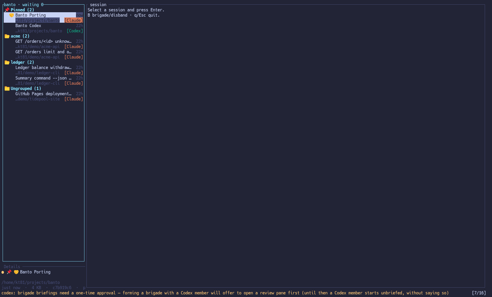

# banto (番頭)

[English](README.md)

*この日本語版は [README.md](README.md) の翻訳です。内容が食い違う場合は英語版が正です。*


**Claude Code と Codex 向けの全画面ターミナル UI です。全セッションを 1 つの検索できる一覧にまとめ、複数を並べて動かし、Director から Worker へ仕事を渡します。**

- セッションを探す。ディスク上の Claude Code と Codex のセッションがすべて、曖昧検索できる 1 つの一覧に並びます。ピン留め、Group への振り分け、アーカイブもできます。1 つ選べば、id を知らなくても再開できます。banto は同じセッションを二度開きません。すでに動いているセッションを再開すると、履歴がフォークするからです。
- 同時に動かす。セッションは一覧の隣にライブのペインとして開き、切り替えているあいだも動き続けます。
- 任せる。Director と Worker のセッションが並んで協調する Brigade を作れます。メンバーは banto のメッセージリレーを介して仕事と報告をやり取りし、自動で作業を進めます。あなたの判断が要るときは、banto がターミナルのベルを鳴らして知らせます。

*番頭（bantō）は、昔ながらの日本の商家で、店に詰めて商いを切り盛りする筆頭の奉公人です。*



*WSL 上で録画し、3〜5 倍速にしています。Goinkyo（Director が相談する助言役のセッション）が考えている間は 40 倍速です。*

## なぜ tmux だけではだめなのか

tmux はターミナルのウィンドウマネージャです。banto は Claude Code と Codex のセッションのライフサイクルマネージャで、セッションの id、ディレクトリ、まだ動いているかどうか、あなたがどう仕分けたかを知っています。行を選ぶと、たまたま `claude` が動いているシェルではなく、特定のひとつの会話、またはその会話をすでに持っているプロセスに戻ります。banto がペインを自分でホストするのは、マルチプレクサにはペインの隣のセッション一覧も、自分の Brigade を知っているセッションも、セッション間で中継されるメッセージも載せられないからです。

## なぜ herdr だけではだめなのか

[herdr](https://github.com/herdrdev/herdr) は、コーディングエージェント向けに作られたターミナルマルチプレクサです。バックグラウンドのサーバーがペインを所有するので、デタッチして後で戻ってこられます。20 を超えるエージェントのうち、どれが作業中か、ブロックされているか、アイドルかも表示します。種類を問わず多数のエージェントを、デタッチやマシン、SSH をまたいで生かし続けたいなら、それは herdr の仕事で、banto にはできません。banto の主題はセッションです。Claude Code と Codex 自身のファイルを読み取り専用で読むので、banto が存在する前や banto の外で始めたセッションも把握でき、同じ会話を二度再開することもありません。また、Director/Worker のセッション間のメッセージを banto 自身が中継します。herdr は、スクリプトやエージェントに CLI とソケット API を渡します。その代わり、banto が話せるエージェントは 2 つで、banto より長生きするサーバーは持ちません。

## できること

左の一覧は**帳場**（chōba、「店の勘定台」の意）です。全セッションを並べたもので、Claude Code が `~/.claude` の下に書くセッションファイルと、Codex が `~/.codex` の下に持つセッション索引から、読み取り専用で作ります。検索、ピン留め、アーカイブ、Group への振り分けができます。新しいセッションは、選んだ、あるいは入力したディレクトリで始められます。選んだセッションは右のペイン（大店、*emporium*）で開き、Vim のバッファのように切り替えながら、バックグラウンドで生かしておけます。すでに開いているセッションを選ぶとそのペインに切り替わり、banto の外のどこか（別の banto や素の `claude`）で動いているセッションは、メッセージを出して拒み、二重には起動しません。

### Director/Worker の Brigade

`B` は、選択したセッションを **Director** に任命し、その隣に新しい **Worker** セッションを起こします。数、モデル、プロダクトは設定でき、Worker は Director とは別に Claude Code と Codex のどちらでも動かせます。Worker のモデルと reasoning effort（推論の強さ）はセッションを作るときだけ渡されます。再起動しても、モデルはセッションが最後に使っていたものが保たれます。effort は Codex ではそのまま保たれますが、Claude Code では手元の Claude 設定から決まるため、そこに保存したレベルだけが引き継がれます（`max` と、そのセッションだけに設定したレベルは再起動までです）。

banto は MCP 上でメンバー間のメッセージを中継します。各メンバーの起動時に `banto _mcp` へつなぎ、Claude Code には `--mcp-config`、Codex には `-c mcp_servers.banto.*` の上書きで渡します。メンバーは `send_to_peer`、`check_messages`、`brigade_status` を使えます。Director にはさらに次のツールがあります。

- `consult_goinkyo` / `dismiss_goinkyo`
- `request_decision`: あなたにしか下せない判断を Director が待つときのものです。banto はその Director に `▸ decision` タグを付け、そのペインで Enter を押すまで残します。Director は止めません
- `interrupt_worker`: Claude の Worker が実行中のターンを Esc 1 回で止め、Director が書いた理由をメッセージとして渡します。Codex の Worker にはメッセージは届きますが、まだ中断はされません
- `name_member`: Worker の常設の役割に表示名を付けます（宛先は引き続きトークンです）

Goinkyo は、Director が `consult_goinkyo` で相談する助言役のセッションです。既定では Director と同じプロダクトで動くため、Codex の Director の Goinkyo は Codex になります（`goinkyo_agent`）。`goinkyo_agent = "claude"` にすると Claude のままです。Codex の Goinkyo は読み取り専用で、承認の確認なしに動くので、ビルドもテストもできません。Codex がまだ信頼していないディレクトリでの最初の相談は、Codex 自身の信頼の質問で止まり、Goinkyo のペインで答えるまで待ちます。Goinkyo のプロダクトが動かせないとき（`agents` で有効になっていない、ホームが見つからない、banto のフックが未信頼または起動できない）、`consult_goinkyo` は最初に拒否します。

各メンバーには、所属する Brigade、トークン、同僚を示す役割ブリーフィングも渡します。Claude Code ではシステムプロンプトへ追記し、Codex では banto 自身の `SessionStart` フックで届けます。中継されたメッセージには、別の AI から来たものだと明示する枠を付けるので、操作者の入力と取り違えられることはありません。banto の**自動リレー**は、未読メッセージがあるアイドルのメンバーに、短い定型の Nudge（催促）を標準入力へ打ち込んで起こします。そのため Director→Worker→Director の往復に人手の橋渡しは要りません。`relay = "auto"` のとき、この起こし方はメンバーの文脈全体に対するターンを始めるので、メッセージに依頼の中身がなくても、アイドルのメンバーは 1 ターン分の費用を使うことがあります。このリポジトリの大部分は、このループで作られました。

生きているメンバー全員が、実際の作業のあと 5 秒間アイドルだったとき、Brigade は静まったとみなされます。あなたの入力が求められる瞬間です。banto は Director に印を付け（一覧の行の待機ドット、マゼンタのペイン枠）、ターミナルのベルを鳴らします。ただし Director のペインを見ているあいだは鳴らしません。`F4` を押すと、そのときも鳴らします（ベルだけで、印は付きません）。

最初の Codex の Brigade を作るときだけ、お願いがあります。Codex は起動時に banto のフックを信頼してよいか確認しますが、確認は初回だけです。そのため banto は、最初の Brigade ができる前に、承認用のペインを 1 回だけ開きます。承認すれば、以降の Brigade はすでに信頼済みです。

## 状況と注意点

- 個人用のツールで、1.0 前で、速いペースで変化しています。インターフェースとディスク上のスキーマは前方へ移行されますが、まだ何も約束していません。UI がデータベースを移行する前に、その隣へ `banto.db.before-v<N>` としてコピーを作ります。これはスキーマ `N - 1` の時点のデータベースで、ビルドのスキーマは `banto --version` で分かります。古いビルドは、新しいビルドが移行したデータベースを開けません。コピーを戻すか、新しいビルドを使ってください。
- **スーパーバイザーは置きません。意図的にそうしています。** banto のペインにホストされたセッションは、banto が終わると終わります。それぞれにまず通常のコンソールクローズを送るので、`claude` はウィンドウを閉じたときと同じように履歴を確定します。banto はあなたが座って使う作業台であって、背後で仕事を動かし続けるデーモンではありません。
- Claude Code のセッションファイルの形式は**ドキュメント化されておらず、変更される可能性があります**。banto は寛容にパースしますが、将来のリリースが banto を驚かせる可能性は残ります。

## 読み取り専用の保証

**banto は `~/.claude` や `~/.codex` の下には何も書き込みません**。セッションファイル、ライブ状態のファイル、履歴、Codex の `threads` と `logs` の sqlite データベースは、すべて厳密に読み取り専用です。banto 自身のファイルは次の場所にあります。

- 設定: 既定では `dirs::config_dir()/banto/config.toml`（Windows: `%APPDATA%\banto\`）。解決順序は[設定](#設定)を参照してください
- データ（sqlite と作業ファイル）: 既定では `dirs::data_local_dir()/banto/banto.db`（Windows: `%LOCALAPPDATA%\banto\`）。設定の `data_dir` か `$BANTO_DATA_DIR` で別の場所を指定できます。`~/.claude` や `~/.codex` の内側にあるデータディレクトリや `db_path` は（どんな名前で到達しても、リンク経由でも）拒否されます。UI と `banto _mcp` は起動に失敗し、エージェントのフックは黙ってストアを開きません

データベースごとに banto の UI はひとつです。実行中の banto がすでに使っているデータベースを開こうとする 2 つ目の `banto` は、起動を拒否します。そのときは、データベースと、分かる場合は保持しているプロセスの id を示します（ロックはデータベースの隣の `banto.db.lock` です）。2 つ目の banto を動かすには、専用のデータディレクトリかデータベース（`BANTO_DATA_DIR`、設定の `data_dir`、`db_path`）を与えてください。

**名指しする例外がひとつあります**。Codex の sqlite データベースは、Codex が書き込み中の可能性があるときに読むので、SQLite 自身の読み取り専用の仕組みを使います。対象はセッション索引の `state_5.sqlite` と、生存確認の `logs_2.sqlite` です。`-wal` ファイルがあれば `mode=ro`、なければ `immutable=1` です。追加の書き込みが避けられないのは、クラッシュの残骸、つまり `-shm` なしに `-wal` が残っているケースだけです。そのとき、最初の `mode=ro` の open が新しい `-shm` を作り直します。約 32KB の一度きりの書き込みです。これは banto のデータではなく SQLite 自身の調整用インデックスで、Codex の次の実行でもどのみち作られます。「banto は書き込まない」という言葉がどの箇所でも文字どおりに成り立つよう、ここに明記します。

## インストールとアップグレード

**必要なもの**。`PATH` 上の `claude`（Claude Code）か `codex`、またはその両方。banto は本物の CLI をホストするもので、同梱はしません。どちらかが別の場所にある場合は、`config.toml` で場所を指定してください。

```toml
[agent_binaries]
claude = "C:/tools/claude.exe"
codex = "C:/tools/codex.exe"
```

**対応プラットフォーム**。Windows x64、Linux x64（glibc 2.35 以降）、Apple silicon の macOS です。リリースは Ubuntu 22.04 でビルドされ、バイナリがそれより新しい glibc を必要とするとビルドが失敗します。Alpine のような musl のシステムはソースからビルドします。Intel Mac と Windows on ARM 向けのビルド済みバイナリはありません。

**macOS は軽く確認した段階です**。Apple silicon の Mac 1 台で、v0.1.0 は `install.sh` でインストールでき、Gatekeeper のプロンプトも出ませんでした。セッションをペインで開いて閉じられ、ペインで選択したテキストもコピーできました。再開、セッションファイルの変更への一覧の追従、入力の細部、ブラウザでダウンロードしたバイナリは、まだ確認していません。

### ワンライナーでインストール

Windows: 開いている PowerShell（Windows PowerShell 5.1 または PowerShell 7）に、次を入力します。`-ExecutionPolicy` のラッパーは不要です。

```powershell
irm https://github.com/kt81/banto/releases/latest/download/install.ps1 | iex
```

Linux と macOS では、次を実行します。

```sh
curl -fsSL https://github.com/kt81/banto/releases/latest/download/install.sh | sh
```

インストーラは、お使いのプラットフォーム用のアーカイブと `SHA256SUMS` をリリースからダウンロードし、一致しなければ何もインストールしません。`SHA256SUMS` はアーカイブと同じリリースから来るので、この確認で分かるのはダウンロードが破損なく届いたことで、誰がビルドしたかではありません。それは[手動インストール](#手動インストール)の attestation で確認します。置き換える前に新しいバイナリを一度実行するので、ここで起動できないビルドは、いま入っている banto に手をつけません。banto ではない `banto` は上書きを拒否し、`PATH` 上に banto が複数あれば警告します。置き換えるのは最初のひとつだけです。`PATH` やシェルのプロファイルは編集しません。ディレクトリが `PATH` にないときは、追加する一行を表示します。

banto は、`PATH` 上にすでにある `banto` の場所に置かれます。なければ `BANTO_INSTALL_DIR` に置かれます。それもなければ、Windows では `%USERPROFILE%\.local\bin\banto.exe`、それ以外では `~/.local/bin/banto` です。次の 2 つの環境変数は、PowerShell では同じウィンドウで先に設定し、Unix シェルではパイプの `sh` 側に付けます。

```powershell
$env:BANTO_VERSION = 'v0.1.0'            # a release tag instead of the latest
$env:BANTO_INSTALL_DIR = 'C:\tools\banto' # where, if no banto is on PATH yet
irm https://github.com/kt81/banto/releases/latest/download/install.ps1 | iex
```

```sh
curl -fsSL https://github.com/kt81/banto/releases/latest/download/install.sh | BANTO_VERSION=v0.1.0 BANTO_INSTALL_DIR="$HOME/bin" sh
```

### 手動インストール

お使いのプラットフォーム用のアーカイブと `SHA256SUMS` を、[Releases ページ](https://github.com/kt81/banto/releases)からダウンロードします。アーカイブ名は `banto-<tag>-x86_64-pc-windows-msvc.zip`、`banto-<tag>-x86_64-unknown-linux-gnu.tar.gz`、`banto-<tag>-aarch64-apple-darwin.tar.gz` です。アーカイブの sha256 を `SHA256SUMS` のその行と比べます（PowerShell では `(Get-FileHash <archive>).Hash`、Linux では `grep <archive> SHA256SUMS | sha256sum -c -`、macOS では `grep <archive> SHA256SUMS | shasum -a 256 -c -`）。そのあと、単一の `banto` / `banto.exe` を、banto の置き場にする唯一のディレクトリへ展開します。バイナリは署名されていません。ブラウザでダウンロードした `banto.exe` をエクスプローラーでダブルクリックすると、SmartScreen の "Windows protected your PC" が出ます。"More info" → "Run anyway" で起動できます。ターミナルから起動した場合や `install.ps1` でインストールした場合は、v0.1.0 ではメンテナーのマシンでプロンプトは出ませんでした。

各アーカイブには、どのコミットとワークフローがビルドしたかを示すビルド来歴の証明（attestation）も付いています。ファイルの出どころを示す、ここにある唯一の確認です。[GitHub CLI](https://cli.github.com/) で検証します。検証するのはアーカイブであって、そこから取り出した exe ではないので、展開する前に実行してください。

```sh
gh attestation verify banto-v0.1.0-x86_64-pc-windows-msvc.zip --repo kt81/banto
```

### ソースからインストール

```sh
cargo install --git https://github.com/kt81/banto banto --locked
```

最近の stable な Rust ツールチェーン（edition 2024）と C コンパイラが必要です（同梱の SQLite は C からコンパイルされます）。`~/.cargo/bin` にインストールされます。

開発用には、チェックアウトから次のようにします。

```sh
cargo build --release

# The UI: the session list on the left, banto-hosted panes on the right
cargo run --

# Plain-text session listing
cargo run -- list

# Point at a different Claude home
cargo run -- --claude-home /path/to/.claude
```

### マシンに banto は一つだけ

banto のバイナリは、スペースを含まないひとつのパスに、ちょうどひとつだけ置いてください。Codex は banto の `SessionStart` フックを、フックの完全なコマンドで信頼します。そのコマンドには banto 自身のパスが含まれるので、別のパスにあるコピーは Codex にとって別のフックです。その場合に最初のコピーの信頼がどうなるかは、信頼ハッシュの作りから推測したもので、観測したものではありません。スペースを含むパスはフックにまったく書き込めないので、Codex のメンバーは役割ブリーフィングなしで起動します。インストーラが常にその場で置き換えるのはそのためです。スペースを含むパスや `PATH` 上の 2 つ目の banto は警告しますが、拒否はしません。同じパスで置き換えて信頼が保たれたのは、観測した 1 件（2026-11-18）だけです。根拠は[この注](docs/notes/codex-briefing-spike.md#addendum-2026-11-18-replacing-banto-at-the-same-path-keeps-the-trust)にあります。

### アップグレード

banto を終了し、同じインストール行を実行して、banto をまた起動します。どちらのインストーラも、置き換え先のファイルから banto が動いているあいだは拒否します（macOS では未検証です）。アップグレード後の最初の起動は、データベースの隣へ `banto.db.before-v<N>` としてコピーを作ってから、その場で移行します（[状況と注意点](#状況と注意点)を参照）。元に戻すには、古いビルドとそのコピーが必要です。

### Windows Defender

2026-11-06、Microsoft Defender がローカルでビルドしたリリース版 `banto.exe` を `Trojan:Win32/Bearfoos.A!ml`（機械学習による検出）として検知し、対処しました。banto とそれがホストしていたすべてのセッションが終了しました（[経緯](docs/notes/windows-defender.md)）。リリースからダウンロードした banto を Defender が検知した場合は、その sha256 を `SHA256SUMS` と比べてください。そのうえで、検出名と定義ファイルのバージョンを添えて[issue を開いてください](https://github.com/kt81/banto/issues)。除外の追加はやめてください。本当に改ざんされたファイルも見えなくなります。

### アンインストール

唯一の `banto` バイナリを削除します（`where.exe banto` / `command -v banto` で見つかります）。banto のデータも消すには、設定ディレクトリとデータディレクトリを削除します。データディレクトリには、`banto.db` とそのロックファイル（`banto.db.lock`、`banto.db.lock.pid`）、`banto.db.before-v<N>` のコピー、作業ファイルがあります。`data_dir`、`BANTO_DATA_DIR`、`db_path` によって別の場所になっていることもあります。セッションは各エージェントが保管している場所に残ります。Codex が `<codex home>/config.toml` に持つ banto のフックの `trusted_hash` は、残しても害はありません。

## キー

ホストしているものがないとき、あるいはすべてアイドルと分かっているときは、`q`/`Esc` は即座に終了します。そうでなければ先に確認を求め、3 秒以内に 2 回目の `q`/`Esc` を押すと終了します。終了すると、ホストしているすべてのプロセスが終わるからです。ステータスバーは、数えた各セッションとその理由を挙げます。たとえば `Esc again to quit — 2 not idle: レビュー (unknown), 実装 (busy)` です。`unknown` は、ペインを読み取れないか、ダイアログが出ている状態です。`input` は直近 3 秒以内に入力を与えた状態、`busy` は作業中、待機中、または banto が読み取れない状態です。`bg` は Claude Code のターンは終わっているがバックグラウンドでコマンドが動いている状態です。終了が決まると、各セッションを順に閉じ、終了するまで最大 5 秒待ちます。

| キー | 動作 |
|---|---|
| `j`/`k`、矢印、`PgUp`/`PgDn`、`Home`/`End` | 選択を移動 |
| `Enter` / ダブルクリック | セッションをペインで開く（すでに開いていればそれに切り替える）。Director では、その Brigade 全体を stage する（ステージに出す） |
| `n` / `/` | 新しいセッション（cwd を選ぶか入力する）/ 検索（曖昧検索、タイトル + cwd） |
| `p` / `d` / `g` / `D` | ピン留め / アーカイブ（ソフトハイド）/ Group に入れる / 選択したアーカイブ済みセッションを復元 |
| `Tab` / `a` | Group 表示（Pinned / Group / Ungrouped）の切り替え / 一覧が見せる範囲を順に切り替える: 通常のセッション → 隠れたもの（エージェントが起動したもの）も → アーカイブ済みも |
| `B` / `b` | Director を任命し、Worker を自動起動する（Director の上では: 解散（disband））/ stage 済みの Brigade に Worker をもうひとつ起こす |
| `x` | 選択した行が動かしているものを終了する（確認あり）。Director では**その Brigade を畳む**（Close Brigade）。Brigade のすべてのプロセスが終わり、何も削除されないので、Director の行で Enter を押せばすべてが戻る。ペインが開いている単独のセッションでは、そのプロセスを終了する。Worker を Brigade から外すことは決してない。それには、その Worker のタイルで `Ctrl+B x` を使う |
| `F2` / `F3` / `F4` | フォーカスを一覧とペインの間で移動する / stage 済みの Brigade の次のペインを現在のペインにする / Director のペインにフォーカスがあってもベルを鳴らす（切り替え） |
| `Ctrl+B` … | tmux 風のプレフィックス（設定可能）。一覧からでもペインからでも使える: |
| … `o`/`Tab`、矢印 | サイドバーとペインの間でフォーカスを順に移す / 方向を指定してペインを移動する |
| … `Shift`+`Up`/`Down` | フォーカス中のスタックのタイルを 1 つ上/下へ動かす |
| … `m` / `z` / `M` | フォーカス中のスタックのタイルを折りたたむ、または開き直す / Solo にする、または Solo を解く / 折りたたまれたタイルをすべて開き、Solo を解く |
| … `=` / `1`-`9` / `s` | stage 済みの Brigade のタイルのサイズを既定に戻す / ペイン N へ移動 / サイドバーに戻る |
| … `x` | フォーカス中の Worker/Goinkyo（ご隠居）を Brigade から外す（dismiss。確認あり。二度と Brigade には戻らず、セッションは残る）。Director や単独のセッションでは、一覧の `x` と同じ |
| … `Esc` / `b` / `Ctrl+B` | プレフィックスを取り消す / プレフィックスのキーそのものを子プロセスに送る |

プレフィックスが有効なあいだは、ステータスバーが全キーバインド表を表示します。マウスでは、ペインやタイルの境界をドラッグしてサイズを変え、スタックのタイルはタイトルをドラッグして動かし、タイトル行の `[S]`（Solo）や `[_]`/`[+]`（折りたたむ/開く）を使えます。その行には、エージェント名と、**busy**、**waiting**、**idle** のいずれかも表示されます。

## 設定

`config.toml` は省略可能で、ファイルがなければ既定値になります。ファイルがある場合はパースできる必要があり（正しい TOML で、既知のキーに、正しい型で、そのキーが取る値が入っていること。`relay = "typo"` は `relay = 5` と同じく拒否されます）、できなければ banto は行と列つきのエラーを表示して起動しません。未知のキーは無視されます。最初に見つかったものが使われます。`--config <path>` と `$BANTO_CONFIG` は、さらに存在していなければなりません。次に、存在すれば `$XDG_CONFIG_HOME/banto/config.toml`、続いて `~/.config/banto/config.toml` が使われます。どちらもなければ、既定の `dirs::config_dir()/banto/config.toml`（Windows では `%APPDATA%\banto\`）です。

```toml
claude_home = "C:/Users/you/.claude"   # 上書き（任意）
db_path = "..."                        # 上書き（任意）。空にすると起動エラー
# banto がデータベースと作業ファイルを置く場所。`$BANTO_DATA_DIR` が優先されます。
# 最初の [section] より上に書いてください。[brigade] の下に置くと brigade.data_dir
# として読まれ、黙って無視されます。変えても何も移動せず、banto は新しい場所で
# 空のデータベースを開きます。
data_dir = "D:/banto-data"

# "all"（既定）| "claude" | "codex" | "claude,codex": banto が索引するプロダクト。
agents = "all"

[activity]
today_hours = 24   # アクティビティドットの区切り
week_days = 7

[brigade]           # Director/Worker の Brigade
workers = 1         # Brigade ごとに自動起動する Worker の数（1..=8）
worker_agent = "inherit"   # "inherit"（Director と同じプロダクト）| "claude" | "codex" | "select"（選択画面: エージェント、モデル、effort）
# Worker の自動圧縮ウィンドウ。起動のたびに渡します（再開も含む）:
# "auto"、100000..=1000000 の整数、または ""（フラグなし）。Director と Goinkyo には渡しません。
# Codex はトークン数だけを受け付けます。"auto" では何も渡しません。
worker_autocompact = 250000
relay = "auto"      # "auto" | "manual" — 起こすための Nudge エンジン
# Brigade のメッセージをすべて全文のまま <data dir>/logs/brigade-<id>.log に追記します。
# このファイルには実際の会話内容が入り、ローテーションも削除もされません。コミットしないでください。
message_log = false
# 各メンバーの役割ブリーフィング。{brigade}、{token}、{peers} は置き換えられます。
# "" ならブリーフィングなしで起動します。既定値は変更してかまわない方針です。既定の
# director_prompt は request_decision を呼ぶ時機も伝えます。自分で書いたものにはその文は入りません。
director_prompt = "..."
worker_prompt = "..."
# Director が頼まれなくても Goinkyo に相談する度合い: "off"（頼んだときだけ）
# | "disputes" | "design" | "decisions"。後ろのものは前のものすべてに上乗せします。これは
# Director のブリーフィング内の指示にすぎず、director_prompt が空なら何も起きません。
# Claude の Director は編集後に banto の再起動が必要です。Codex の Director はフックが
# 次のセッション開始時に読み直します。動いている Director は変更を知りません。ペインで伝えてください。
goinkyo_consult = "design"
# Goinkyo が動くプロダクト: "inherit"（Director と同じ）| "claude" | "codex"。
# Codex の Goinkyo は読み取り専用（-s read-only -a never）で動くため、ビルドもテストもできません。
# モデルと effort は [brigade.codex] の goinkyo_model と goinkyo_effort です。
goinkyo_agent = "inherit"
# Director の request_decision は、行に印を付けてベルも鳴らします。false なら印だけです。
request_attention = true

# 片方のプロダクトだけが読む設定は、そのプロダクトのテーブルに置きます。これらのテーブルは、
# 上にあるすべての [brigade] の通常のキーより下に書いてください。テーブルの下に書いた通常の
# キーはそのテーブルのキーとして読まれるため、banto 自身のキーがそこにあると起動を拒否します。モデル、effort、パーミッションモードは
# 新しい Worker や Goinkyo に、作成時にだけ渡します。"" ならフラグを渡しません。
# [brigade] 直下の古い書き方（worker_model、worker_effort、worker_model_codex、
# worker_effort_codex、worker_permission_mode、goinkyo_model、goinkyo_effort、
# goinkyo_permission_mode、goinkyo_disallowed_tools）も引き続き読まれ、見つけたものは
# 起動時に banto が知らせます。両方あるときはテーブルが優先されます。
[brigade.claude]
worker_model = "sonnet"          # --model
worker_effort = "high"           # --effort (low | medium | high | xhigh | max)
worker_permission_mode = "auto"  # --permission-mode
# Fable と max は既定ではなく、選んで使うものです。Fable は一部のプランで使用クレジットに
# 課金され、max は Claude が保存できないため再起動で外れます。
goinkyo_model = "opus"
goinkyo_effort = "xhigh"
goinkyo_permission_mode = "auto"

[brigade.codex]
worker_model = "terra"           # slug、または最新の slug に解決されるファミリー名
worker_effort = "high"           # -c model_reasoning_effort
goinkyo_model = ""               # Codex の Goinkyo のモデル。"" は Codex の既定
goinkyo_effort = ""              # Codex の Goinkyo の -c model_reasoning_effort。"" は渡さない

[keys]
prefix = "C-b"      # ペインのプレフィックスのキー
```

## 参考資料

[docs/REQUIREMENTS.md](docs/REQUIREMENTS.md) に設計と要件、[docs/DISCIPLINE.md](docs/DISCIPLINE.md) にアーキテクチャの規律（純粋なコアと、端に寄せた I/O）、[docs/notes/](docs/notes/) に実機での検証ノートがあります。[tools/measure/](tools/measure/README.md) には、エージェントのチームがどれだけ使い、その変更がレビューでどうなるかを測る Python スクリプトがあります（ビルドには含まれません）。

## ライセンス

ライセンスの条文は、法的な文言として英語のまま掲載します。英語の条文が正です。

Licensed under either of [Apache License, Version 2.0](LICENSE-APACHE) or
[MIT license](LICENSE-MIT) at your option.

Unless you explicitly state otherwise, any contribution intentionally
submitted for inclusion in the work by you, as defined in the Apache-2.0
license, shall be dual licensed as above, without any additional terms or
conditions.
